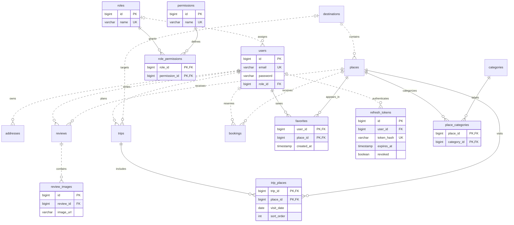

# TravelHub

A portfolio-oriented Java backend for travel discovery, reviews, favorites, itinerary planning and reservations. The project demonstrates feature-oriented layered architecture, transactional business rules, PostgreSQL migrations, Redis caching, bounded AI integration and database-backed authorization.

## Features

- Destination and category management; place search, filters, sorting, popular and top-rated lists.
- User profiles, addresses with one default per user, reviews with image URLs and transactional rating aggregation.
- Favorites, trips and ordered daily itineraries with date validation.
- Booking creation, pending-booking edits and explicit confirm/cancel/complete actions.
- Aggregated administration dashboard and paginated management APIs.
- Redis caches with configurable TTLs and after-commit invalidation.
- AI review summaries and personalized recommendations using database-selected candidates.
- BCrypt passwords, JWT access tokens, rotating refresh tokens, roles, permissions and ownership checks.
- OpenAPI/Swagger, Actuator health, Docker Compose and real PostgreSQL/Redis integration tests.

## Architecture

```text
Frontend / API client
        |
        v
REST controllers + request validation
        |
        v
Domain services + transactions + authorization
        |
        +-- Manual mappers --> response DTOs
        +-- JPA repositories --> PostgreSQL
        +-- Spring Cache --> Redis
        +-- AiService --> LlmClient --> external AI API
```

Controllers never access repositories or AI providers directly. Entities are not serialized to clients. Relationships use lazy, mostly unidirectional mappings and explicit join entities with embedded composite keys. Open Session in View is disabled.

## Technology Stack

| Area | Technology |
| --- | --- |
| Runtime | Java 21, Spring Boot 3.5.16, Maven |
| HTTP | Spring MVC, Jakarta Validation, SpringDoc OpenAPI |
| Persistence | Spring Data JPA, Hibernate, PostgreSQL 17, Flyway |
| Caching | Spring Cache, Redis 7, typed JSON serialization |
| Security | Spring Security, BCrypt, JJWT |
| AI | Spring RestClient, OpenAI-compatible Chat Completions |
| Testing | JUnit 5, Mockito, MockMvc, Testcontainers |
| Deployment | Multi-stage Docker image, non-root runtime, Docker Compose |

## Quick Start With Docker

Install Docker with Compose and start the Docker daemon.

```bash
docker compose up --build
```

The default development profile works without an AI key or a configured JWT secret. An ephemeral JWT signing key is generated for development only, so access tokens stop working after a restart unless `JWT_SECRET` is configured.

- [Swagger UI](http://localhost:8080/swagger-ui.html)
- [OpenAPI JSON](http://localhost:8080/v3/api-docs)
- [Destinations API](http://localhost:8080/api/v1/destinations)
- [Health](http://localhost:8080/actuator/health)

PostgreSQL is exposed on `127.0.0.1:5433`, Redis on `127.0.0.1:6379`, and the API on `127.0.0.1:8080`. PostgreSQL uses host port 5433 to avoid an existing local 5432 listener. Override `POSTGRES_PORT`, `REDIS_PORT` or `SERVER_PORT` if needed. Inside Compose the backend connects to `postgres:5432` and `redis:6379`, not localhost.

```bash
docker compose up -d --build
docker compose ps
docker compose logs -f backend
docker compose down
```

For a deliberate reset of disposable development data:

```bash
docker compose down -v
```

**The `-v` command permanently deletes the project database volume.** Do not use it on data you need to retain.

### Development Accounts

The dev profile seeds ten categories, six destinations, eight illustrative places, two sample travelers, sixteen reviews, an itinerary, a favorite, an address and two bookings. These are demonstration records, not real pricing or availability. Seeding is transactional and does not recreate listings once destinations exist.

Sample travelers have randomly generated, undisclosed BCrypt passwords. Register your own account to try member workflows. No default administrator password is embedded in the project.

To enable an administrator, create your local configuration from the example:

```bash
cp .env.example .env
```

Set `DEV_ADMIN_PASSWORD` to a unique password of 8-72 UTF-8 bytes and optionally change `DEV_ADMIN_EMAIL`. Restart the backend with `docker compose up -d`, then log in normally. Bootstrap creates a new account only: it does not promote an existing account or reset its password. Use a fresh email if that address was previously registered. `.env` is ignored by Git and Docker builds.

Dev seed is disabled in production, including when both `dev` and `prod` profiles are selected.

## Run Locally

Requirements: JDK 21+, Maven 3.9+ (or the supplied Maven wrapper), and Docker for the database, Redis and integration tests.

```bash
docker compose up -d postgres redis
mvn spring-boot:run -Dspring-boot.run.profiles=dev
```

Local defaults connect to PostgreSQL on port 5433 and Redis on port 6379. Maven does not automatically load `.env`; provide environment variables through your shell or IDE when overriding defaults. When changing `POSTGRES_PORT` for Compose, also update the host application's `DB_URL`.

```bash
mvn clean verify
java -jar target/travelhub-1.0.0-SNAPSHOT.jar --spring.profiles.active=dev
```

## Configuration

See [.env.example](.env.example) for a complete example.

| Variable | Default / Meaning |
| --- | --- |
| `SPRING_PROFILES_ACTIVE` | Compose uses `dev`; production uses `prod` |
| `DB_URL` | Host default `jdbc:postgresql://localhost:5433/travelhub`; Compose sets its own internal URL |
| `DB_NAME`, `DB_USERNAME`, `DB_PASSWORD` | Development defaults `travelhub`; replace credentials outside local development |
| `POSTGRES_PORT`, `REDIS_PORT`, `SERVER_PORT` | Host ports 5433, 6379, 8080 |
| `REDIS_HOST` | `localhost` outside Compose |
| `JWT_SECRET` | At least 32 bytes; required outside dev/test. Use a high-entropy value |
| `JWT_ACCESS_TTL`, `JWT_REFRESH_TTL` | `15m`, `7d` |
| `DEV_SEED_ENABLED` | `true` in dev; `false` disables both sample data and dev admin bootstrap |
| `DEV_ADMIN_EMAIL`, `DEV_ADMIN_PASSWORD` | Optional dev-only administrator; password is empty by default |
| `CACHE_ENABLED` | `true` |
| `DESTINATION_CACHE_TTL`, `PLACE_CACHE_TTL` | `30m`, `10m` |
| `RANKING_CACHE_TTL`, `SUMMARY_CACHE_TTL` | `5m`, `30m` |
| `AI_ENABLED`, `AI_API_KEY` | `false`, empty |
| `AI_BASE_URL`, `AI_MODEL` | `https://api.openai.com/v1`, `gpt-4o-mini`; configurable for compatible providers |
| `AI_TIMEOUT` | `20s` |
| `AI_MAX_REVIEWS`, `AI_MAX_REVIEW_CHARS` | 30 reviews, 1000 characters per review |
| `AI_MAX_CANDIDATES`, `AI_MAX_OUTPUT_TOKENS` | 30 candidates, 1500 output tokens |
| `SWAGGER_ENABLED` | `false` in prod; Swagger is enabled in dev/test |

The JWT key can be generated locally with `openssl rand -hex 32`. Keep it in your environment or secret manager, not source control. Profiles live in `application.yml`, `application-dev.yml`, `application-prod.yml` and test resources' `application-test.yml`.

### Production Notes

All profiles use `ddl-auto=validate`; Flyway owns schema changes. Production requires explicitly configured database credentials and JWT secret, has no demo seeding, disables Swagger by default, and exposes only the non-detailed health Actuator endpoint.

The Compose file is for local development. Before an internet-facing deployment, terminate TLS at a trusted proxy, add authentication/AI rate limits, configure private database/Redis networking, backups, centralized observability and managed secrets. No permissive cross-origin policy is enabled. CSRF is disabled because authentication is stateless via an explicit Authorization header, not cookies.

To provision the first production administrator, register an account and have a trusted database operator assign the existing `ADMIN` role to that verified account. There is deliberately no public role-escalation endpoint or production default password.

## Database And ERD



Full column definitions, constraints and indexes are in [Flyway migrations](src/main/resources/db/migration).

| Migration | Responsibility |
| --- | --- |
| V1 | Users, roles, permissions, role-permission links, addresses |
| V2 | Destinations, categories, places, place-category links |
| V3 | Reviews, review images, favorites |
| V4 | Trips, itinerary links, bookings |
| V5 | Foreign-key, ranking and collection indexes; case-insensitive uniqueness and single-default-address constraint |
| V6 | Initial USER/OWNER/ADMIN permission mappings and hashed refresh tokens |

Auditing timestamps use UTC instants. Local booking dates/times are interpreted in the destination's timezone (UTC if absent). Join-table primary keys prevent duplicate favorites, categories and itinerary entries. Database checks complement application validation. A partial unique index allows at most one default address per user.

Flyway will not silently baseline or overwrite a legacy Hibernate-created schema. Point the application at a fresh database, or plan an explicit, backed-up migration of existing data. Do not enable automatic schema updates in production.

## Authentication And Authorization

```http
POST /api/v1/auth/register
Content-Type: application/json

{"email":"traveler@example.test","password":"replace-with-a-unique-password","fullName":"Traveler"}
```

Registration and login return `accessToken`, `refreshToken` and `tokenType: Bearer`. Login accepts email and password. Refresh accepts `{"refreshToken":"..."}` at `POST /api/v1/auth/refresh`. Each successful refresh revokes the old refresh token and creates a new pair. Only a SHA-256 digest of the random refresh token is stored. Expired/reused tokens return 401.

Use `Authorization: Bearer <accessToken>` or Swagger's **Authorize** button. Access JWTs are signed with HS256 and validated for issuer, signature, type and expiry. Authorities are loaded from the database on each request, so role changes, permission changes and account deletion affect existing tokens immediately.

| Actor | Default Access |
| --- | --- |
| Public | Read destinations, categories, places, rankings and reviews; register/login/refresh; health |
| USER | Own profile, addresses, favorites, trips, bookings and recommendations; create/edit/delete own reviews |
| OWNER | USER capabilities plus `PLACE_CREATE` |
| ADMIN | Catalog management, cross-user administration, dashboard, booking confirmation/completion and role/permission management |

Personal APIs use `/me`. Legacy `/users/{id}` routes are administrative only. Ordinary members cannot impersonate another account by putting `userId` in a create request: it is derived from the authenticated principal. Admin may supply a user ID for on-behalf creation. Responses never contain password hashes or refresh-token hashes.

There is no place-owner relationship in the requested schema. Consequently OWNER does not receive global place-update/delete privileges or permission to confirm other users' bookings. Adding genuine place ownership is a future domain extension. The seeded `BOOKING_DELETE` permission is reserved; bookings are cancelled through explicit actions, not deleted through an arbitrary status or delete API.

## API Overview

All paths below are relative to `/api/v1`. The [generated OpenAPI document](http://localhost:8080/v3/api-docs) describes request/response schemas and errors.

| Feature | Endpoints |
| --- | --- |
| Authentication | `POST /auth/register`, `/auth/login`, `/auth/refresh` |
| Destinations | `GET/POST /destinations`, `GET/PUT/DELETE /destinations/{id}`, `GET /destinations/{id}/places` |
| Categories | `GET/POST /categories`, `GET/PUT/DELETE /categories/{id}` |
| Places | `GET/POST /places`, `GET/PUT/DELETE /places/{id}`, `GET /places/popular`, `/places/top-rated` |
| Profile | `GET/PUT/DELETE /me`; admin also has `POST /users`, `GET/PUT/DELETE /users/{id}` |
| Addresses | `GET/POST /me/addresses`, `GET/PUT/DELETE /addresses/{id}`, `PUT /addresses/{id}/default` |
| Reviews | `GET/POST /places/{id}/reviews`, `GET/PUT/DELETE /reviews/{id}` |
| Images | `POST /reviews/{id}/images`, `DELETE /review-images/{id}` |
| Favorites | `GET /me/favorites`, `POST/DELETE /me/favorites/{placeId}` |
| Trips | `POST /trips`, `GET /me/trips`, `GET/PUT/DELETE /trips/{id}` |
| Itinerary | `GET/POST /trips/{id}/places`, `PUT/DELETE /trips/{id}/places/{placeId}` |
| Bookings | `POST /bookings`, `GET /me/bookings`, `GET/PUT /bookings/{id}`, `PUT /bookings/{id}/confirm\|cancel\|complete` |
| AI | `GET /places/{id}/review-summary`, `GET /me/recommendations?destinationId=1&limit=10` |
| Dashboard | `GET /admin/dashboard/overview\|users\|bookings\|places` |
| Admin Management | `GET /admin/users\|reviews\|bookings\|places`, `GET/DELETE /admin/users/{id}`, `DELETE /admin/reviews/{id}` |
| RBAC | `GET/POST /admin/roles\|permissions`, `PUT /admin/roles/{id}/permissions`, `PUT /admin/users/{id}/role` |

### Search And Pagination

```http
GET /api/v1/destinations?keyword=da&country=Vietnam&page=0&size=10&sort=name,asc
GET /api/v1/places?destinationId=1&categoryId=2&minRating=4&maxPriceLevel=2&bookingEnabled=true&page=0&size=20&sort=name,asc
GET /api/v1/places/1/reviews?page=0&size=10&sort=createdAt,desc
GET /api/v1/admin/bookings?status=PENDING&dateFrom=2026-11-01&dateTo=2026-11-30
```

Collection responses contain `content`, `page`, `size`, `totalElements`, `totalPages`, `first` and `last`. Default size is 20 and maximum is 100. Sort fields are allowlisted; arbitrary property paths are rejected. Itineraries always use `visitDate, sortOrder, placeId`; popular/top-rated endpoints use their documented fixed ranking with stable tie-breakers.

### Business Rules

- Referenced destinations, places and users cannot be deleted while dependent business records exist.
- Creating/updating/deleting reviews locks the parent place, flushes changes, and recalculates average rating and review count within one transaction.
- Address writes lock the user; setting a default clears other defaults. Deleting the default promotes the oldest remaining address.
- Duplicate favorite creation returns 409; removal is idempotent when the user and place exist.
- Trip dates and budget are validated; changing trip dates also revalidates existing itinerary entries.
- Booking creation requires an enabled place, a non-past local date and a positive party size. Only pending bookings can be edited.
- Allowed booking transitions: `PENDING -> CONFIRMED/CANCELLED`, `CONFIRMED -> COMPLETED/CANCELLED`. Completed and cancelled bookings are terminal.
- Review images are URLs, limited to ten per review; they are not uploaded or fetched by the backend.

Creates return 201, deletes return 204. Validation/business errors return 400; authentication 401; authorization 403; missing resources 404; duplicates/integrity/concurrency conflicts 409. Errors use `timestamp, status, error, message, path, errors`. Unexpected exceptions do not leak internal details.

## Redis And AI

Cached DTOs: destination details/lists, place details, popular/top-rated lists and review summaries. Redis stores typed JSON, never JPA entities or Java serialization. Related mutations evict caches after database commit. Redis failures are logged without request secrets and fall back to the database; failed deferred cache writes do not turn a committed database operation into an API failure. TTLs bound stale entries if an invalidation fails.

AI controllers delegate to domain services, which take bounded database snapshots before invoking the provider outside the transaction. Recommendations use favorites, positive reviews, category matches, trip destinations and ratings to select candidates. The model may only rerank/explain those candidate IDs; unknown IDs, duplicates, invalid scores and malformed responses are rejected.

The provider contract is [OpenAI-compatible Chat Completions](https://developers.openai.com/api/reference/resources/chat/subresources/completions/methods/create), using JSON output, configurable timeouts and output limits. Configure `AI_ENABLED=true`, a provider key and a compatible model to make live calls. Review summaries with no reviews return a deterministic empty-history result. Otherwise disabled/unavailable AI returns 503; invalid structured model output returns 502. No invented AI response is returned on failure.

Reviews and bounded preference history are sent to the configured provider; passwords, emails, tokens and database credentials are not included. Account for user consent and provider data-retention policy before enabling this in a real product. Provider protocol and parsing are tested with a mock server; a live paid API call is not part of the test suite.

## Testing

```bash
mvn clean verify
mvn -Dtest=PlaceApiIntegrationTest,BookingIntegrationTest,SecurityIntegrationTest test
```

Docker must be running. Integration tests use PostgreSQL 17 and Redis 7 Testcontainers, create the schema through Flyway and validate JPA mappings. They intentionally fail if Docker is unavailable rather than silently skipping database coverage.

Coverage includes CRUD/search, DTO validation, database constraints, rating calculations, concurrent review writes, concurrent default addresses/favorites, trip dates, booking transitions, Redis serialization/invalidation/failure behavior, AI protocol/schema validation, real JWT login/refresh, cross-user isolation and live permission changes. Tests do not use a paid AI key.

Latest verification: **93 tests passed**, no failures/errors/skips. The final Compose stack was also smoke-tested over HTTP on Java 21, including authentication, RBAC, itinerary, reviews, cache invalidation and refresh rotation.

See [phase verification history](docs/implementation-log.md). Source formatting uses [google-java-format](https://github.com/google/google-java-format) with its four-space `--aosp` style.

## Project Structure

```text
src/main/java/com/travelhub/
  common/       exceptions, responses, audited base entity, pagination helpers
  config/       JPA, Redis, AI, OpenAPI, clock and dev-only sample data
  destination/  controller, dto, entity, mapper, repository, service
  category/     catalog categories
  place/        listings, category links and Specifications
  user/         profiles, roles and permissions
  address/      address management
  review/       reviews, images and rating aggregation
  favorite/     user-place links
  trip/         trips and itinerary
  booking/      reservations and state transitions
  admin/        aggregates, management and RBAC administration
  ai/           domain AI abstraction, candidate selection and LLM client
  security/     JWT filter, principal, ownership, auth and /me APIs
src/main/resources/
  application*.yml
  db/migration/
src/test/
  java/com/travelhub/
  resources/application-test.yml
```

## Future Improvements

Booking capacity/time slots, explicit place-owner relationships, file storage through S3/Cloudinary, verified emails and password recovery, refresh-token family revocation/logout, scheduled expired-token cleanup, production rate limiting and tracing, full-text/geospatial search, and CI deployment are natural next steps. They are deliberately separate from the implemented core.
